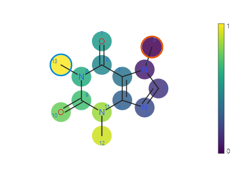
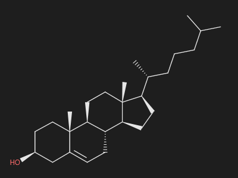
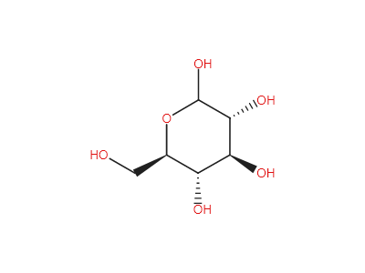

# MolDraw.Net

**2D chemical structures for .NET — draw, highlight and interact with molecules in .NET MAUI, Avalonia, WPF or on
the server.** Rendering with [SkiaSharp 4.156](https://github.com/mono/SkiaSharp), chemistry with
[NCDK](https://github.com/kazuyaujihara/NCDK) — or with your own engine: the renderer only sees a toolkit-neutral
depiction model.

[](https://www.nuget.org/packages/MolDraw.Maui)
[](https://www.nuget.org/packages/MolDraw.Skia)
[](https://www.nuget.org/packages/MolDraw.Core)
[](https://www.nuget.org/packages/MolDraw.Depiction)
[](LICENSE)
[](https://dotnet.microsoft.com)
[](https://github.com/Agredo/MolDraw.Net/actions/workflows/ci.yml)

<table>
<tr>
<td></td>
<td></td>
<td></td>
</tr>
<tr>
<td align="center"><sub>Per-atom heat-map + colour bar</sub></td>
<td align="center"><sub>Dark preset</sub></td>
<td align="center"><sub>Light preset, stereo wedges</sub></td>
</tr>
</table>

## What you get

* **Public molecules from a SMILES string** in one line — parse, 2D layout, depict, cache. Off the UI thread, cached by
  SMILES, errors surfaced as a bindable `ErrorMessage` instead of exceptions.
* **Per-atom highlighting** for heat maps, ML/spectra output, selection or search hits: weights 0–1 mapped through
  Viridis, Plasma, Inferno, Magma, Turbo or a custom colour map, plus explicit per-atom/per-bond colours.
* **Interaction**: tap to select, pointer hover on desktop, hit testing on the rendered canvas — all as MVVM bindings
  (`SelectedAtomIndex`, `HoveredAtomIndex`, `AtomTappedCommand`).
* **Engine-neutral by design**: RDKit, Indigo, OpenChemLib, a CSV of coordinates or your own layout can feed the same
  renderer. NCDK is one engine among others, not a requirement.
* **No UI framework required**: the same renderer exports PNG and SVG and draws into any `SKCanvas` — ASP.NET Core,
  console tools, Azure Functions, Avalonia custom draw ops.
* **LGPL-aware packaging**: `MolDraw.Depiction`, `MolDraw.Skia` and `MolDraw.Maui` are NCDK-free. NCDK (LGPL-2.1)
  enters only through `MolDraw.Core`, i.e. only if you ask for the built-in engine.
* **x64 and ARM64**, Windows, Android, iOS, Mac Catalyst, Linux and macOS.

## Packages

| Package | Depends on | Purpose |
|---|---|---|
| `MolDraw.Depiction` | – | Immutable, toolkit-neutral depiction model (atoms, bonds, rings, 2D coordinates) + the `IChemistryEngine` seam |
| `MolDraw.Core` | Depiction, NCDK | NCDK engine: SMILES/MOL/SDF → `IAtomContainer` → `MoleculeDepiction` |
| `MolDraw.Skia` | Depiction, SkiaSharp | Renderer, highlights, colour maps, hit testing, PNG/SVG export |
| `MolDraw.Maui` | Depiction, Skia, MAUI | `MoleculeView` control + `UseMolDraw()` (contains no chemistry toolkit) |

The renderer never sees NCDK types, so `MolDraw.Skia` can be used without NCDK (e.g. with RDKit coordinates) and
without MAUI (Avalonia, ASP.NET Core, console). See [docs/ARCHITECTURE.md](docs/ARCHITECTURE.md).

## Contents

[Installation](#installation) · [MAUI quick start](#maui-quick-start) ·
[`MoleculeView` properties](#moleculeview-properties) · [Highlights](#highlighting) ·
[Customisation](#customisation) · [Without MAUI](#without-maui-server-avalonia) ·
[Other engines](#using-another-chemistry-engine-rdkit-indigo-) · [Platforms](#supported-platforms) ·
[Limitations](#known-limitations) · [Building](#building) · [ARM64](#arm64) · [Project](#project)

## Installation

```shell
dotnet add package MolDraw.Maui          # MAUI apps (pulls Skia; add Core for SMILES)
dotnet add package MolDraw.Core          # the NCDK chemistry engine
dotnet add package MolDraw.Skia          # rendering only (Avalonia/server)
```

Requirements: .NET 11, SkiaSharp **4.156.x**, .NET MAUI 11 for `MolDraw.Maui`.
The packages are architecture-neutral (`net11.0`, `net11.0-android`, `net11.0-ios`, `net11.0-maccatalyst`,
`net11.0-windows10.0.19041.0`) and run on **x64 and ARM64**; the native Skia binaries are restored by SkiaSharp for
the consuming app's RID (`win-arm64`, `android-arm64`, `osx`, `maccatalyst`, `ios`). See [ARM64](#arm64).

### Upgrading from 0.1.x

`MoleculeLoader`, `IMoleculeLoader`, `DepictionBuilder` and `IDepictionBuilder` moved from `MolDraw.Core` to
`MolDraw.Core.Ncdk`, so that the NCDK-bound API is visible as such. Add one using directive; nothing else changed:

```csharp
using MolDraw.Core.Ncdk;    // new in 0.2.0
```

`MoleculeLoaderOptions`, `DepictionBuildOptions`, `MoleculeFormat`, `CarbonLabelMode` and the exceptions stayed in
`MolDraw.Core`.

### Upgrading from 0.2.x

The chemistry engine is now behind an interface, so `MolDraw.Maui` no longer references `MolDraw.Core` (and therefore
no longer pulls in NCDK, LGPL). Three changes:

1. **Register an engine for SMILES.** `UseMolDraw()` only adds the renderer and cache.

   ```csharp
   builder.UseMauiApp<App>().UseMolDraw();
   builder.Services.AddMolDrawCore();      // from MolDraw.Core (NCDK); add the package + a using
   ```

   Binding `MoleculeView.Depiction` needs no engine at all.
2. **`MoleculeView.Molecule` was removed.** Bind your NCDK molecule's depiction instead:
   `Depiction="{Binding MolDepiction}"` (built once with `IDepictionBuilder.Build(mol)`).
3. **Engine-neutral types moved** from `MolDraw.Core` to `MolDraw.Depiction`: `IChemistryEngine`,
   `DepictionBuildOptions`, `CarbonLabelMode`, `MoleculeParseException`, `DepictionException`. `MoleculeLoaderOptions`
   and `MoleculeFormat` moved to `MolDraw.Core.Ncdk`. Add the matching using directive.

## MAUI quick start

```csharp
// MauiProgram.cs
builder.UseMauiApp<App>()
       .UseMolDraw();                       // UseSkiaSharp() + renderer + depiction cache
builder.Services.AddMolDrawCore();          // the chemistry engine (NCDK): SMILES -> depiction
```

```xml
<ContentPage xmlns:md="clr-namespace:MolDraw.Maui;assembly=MolDraw.Maui" ...>
    <md:MoleculeView Smiles="{Binding Smiles}"
                     AtomWeights="{Binding AtomWeights}"
                     Colormap="{Binding Colormap}"
                     ShowColorBar="True"
                     SelectedAtomIndex="{Binding SelectedAtomIndex}"
                     HoveredAtomIndex="{Binding HoveredAtomIndex}"
                     AtomTappedCommand="{Binding AtomTappedCommand}"
                     ErrorMessage="{Binding SmilesError}" />
</ContentPage>
```

### MVVM example (CommunityToolkit.Mvvm)

```csharp
public partial class PeakViewModel : ObservableObject
{
    [ObservableProperty] private string smiles = "CC(=O)OC1=CC=CC=C1C(=O)O";
    [ObservableProperty] private IReadOnlyList<float>? atomWeights;   // one value per atom index, 0..1
    [ObservableProperty] private int? selectedAtomIndex;              // two-way: tap selects/deselects
    [ObservableProperty] private string? smilesError;                 // pushed by the control

    partial void OnSelectedAtomIndexChanged(int? value) => HighlightPeaksForAtom(value);

    public void ShowPeak(float[] modelOutput) => AtomWeights = modelOutput; // assign a new list to refresh

    [RelayCommand] private void AtomTapped(int atomIndex) { /* ... */ }
}
```

### `MoleculeView` properties

| Property | Default mode | Purpose |
|---|---|---|
| `Smiles` | OneWay | Depicted by the registered `IChemistryEngine`, cached by SMILES |
| `Depiction` (`MoleculeDepiction`) | OneWay | Precomputed depiction, e.g. from another toolkit (precedence over `Smiles`) |
| `DepictionOptions` | OneWay | Layout/label options for `Smiles` |
| `RenderOptions` | OneWay | `null` → `Light`/`Dark` preset following `Application.RequestedTheme` |
| `AtomWeights` (`IReadOnlyList<float>`) | OneWay | Per-atom 0..1, mapped through `Colormap` |
| `AtomColors`, `BondColors` (`IReadOnlyDictionary<int, SKColor>`) | OneWay | Explicit highlight colours |
| `Colormap`, `ShowColorBar`, `HighlightRadiusScale` | OneWay | Highlight customisation |
| `SelectedAtomIndex` (`int?`) | **TwoWay** | Tap selects, tapping again/empty space deselects |
| `HoveredAtomIndex` (`int?`) | **OneWayToSource** | Pointer hover (desktop) |
| `AtomTappedCommand`, `AtomHoveredCommand` | – | `ICommand` with the atom index (`int`, hover: `int?`) |
| `ErrorMessage` (`string?`) | **OneWayToSource** | Invalid input; also drawn inside the control, never thrown |
| `IsInteractive`, `HitTolerance` | OneWay | Pointer handling |

## SMILES vs. depiction

* **SMILES** – simplest; parsing + 2D layout (NCDK `StructureDiagramGenerator`) run off the UI thread and are cached.
  Requires a registered `IChemistryEngine`.
* **`MoleculeDepiction`** – full control or other toolkits. Build it yourself (atom `i` must have `Index == i`) or with
  `IDepictionBuilder.Build(molecule)` and reuse it. Recolouring never recomputes coordinates. See
  [Using another chemistry engine](#using-another-chemistry-engine-rdkit-indigo-).

### Atom order guarantee

Depiction atom `i` == atom `i` of the parsed molecule == the `i`-th heavy atom in the SMILES, which is the same order as
RDKit `Chem.MolFromSmiles` (verified against RDKit-generated fixtures in the tests). Simple explicit hydrogens
(`[H]`) are folded into implicit counts like RDKit's `RemoveHs`; isotopic/charged hydrogens stay atoms.
Use `MoleculeLoaderOptions.KeepExplicitHydrogens = true` to keep them all. Per-atom model outputs can therefore be bound
directly to `AtomWeights`.

### Using another chemistry engine (RDKit, Indigo, …)

`MoleculeDepiction` is the *only* contract between chemistry and rendering. Build it from whatever produces your
coordinates — RDKit, Indigo, OpenChemLib, a CSV, or your own layout — and hand it to the renderer, the exporter or
`MoleculeView.Depiction`. **No NCDK code runs on that path.** `MolDraw.Skia` (and `MolDraw.Depiction`) do not reference
NCDK at all.

```csharp
using MolDraw.Depiction;
using MolDraw.Skia;
using SkiaSharp;

// Phenol, coordinates and atom order as delivered by another toolkit (e.g. RDKit `AllChem.Compute2DCoords`).
var atoms = new[]
{
    new DepictionAtom(0, "C",  1.500,  0.000, 0, 0, null, false, HydrogenPosition.Right) { AtomicNumber = 6, IsAromatic = true },
    new DepictionAtom(1, "C",  0.750,  1.299, 1, 0, null, false, HydrogenPosition.Right) { AtomicNumber = 6, IsAromatic = true },
    new DepictionAtom(2, "C", -0.750,  1.299, 1, 0, null, false, HydrogenPosition.Right) { AtomicNumber = 6, IsAromatic = true },
    new DepictionAtom(3, "C", -1.500,  0.000, 1, 0, null, false, HydrogenPosition.Right) { AtomicNumber = 6, IsAromatic = true },
    new DepictionAtom(4, "C", -0.750, -1.299, 1, 0, null, false, HydrogenPosition.Right) { AtomicNumber = 6, IsAromatic = true },
    new DepictionAtom(5, "C",  0.750, -1.299, 1, 0, null, false, HydrogenPosition.Right) { AtomicNumber = 6, IsAromatic = true },
    new DepictionAtom(6, "O",  3.000,  0.000, 1, 0, null, true,  HydrogenPosition.Right) { AtomicNumber = 8 },
};

var bonds = new[]
{
    new DepictionBond(0, 1, BondOrder.Aromatic, BondStereoDisplay.None, DoubleBondPlacement.Center) { Index = 0, KekuleOrder = BondOrder.Single, IsInRing = true },
    new DepictionBond(1, 2, BondOrder.Aromatic, BondStereoDisplay.None, DoubleBondPlacement.Center) { Index = 1, KekuleOrder = BondOrder.Double, IsInRing = true },
    new DepictionBond(2, 3, BondOrder.Aromatic, BondStereoDisplay.None, DoubleBondPlacement.Center) { Index = 2, KekuleOrder = BondOrder.Single, IsInRing = true },
    new DepictionBond(3, 4, BondOrder.Aromatic, BondStereoDisplay.None, DoubleBondPlacement.Center) { Index = 3, KekuleOrder = BondOrder.Double, IsInRing = true },
    new DepictionBond(4, 5, BondOrder.Aromatic, BondStereoDisplay.None, DoubleBondPlacement.Center) { Index = 4, KekuleOrder = BondOrder.Single, IsInRing = true },
    new DepictionBond(5, 0, BondOrder.Aromatic, BondStereoDisplay.None, DoubleBondPlacement.Center) { Index = 5, KekuleOrder = BondOrder.Double, IsInRing = true },
    new DepictionBond(0, 6, BondOrder.Single,   BondStereoDisplay.None, DoubleBondPlacement.Center) { Index = 6, KekuleOrder = BondOrder.Single },
};

var depiction = new MoleculeDepiction(atoms, bonds)
{
    Rings = [new DepictionRing([0, 1, 2, 3, 4, 5], IsAromatic: true)],
};

File.WriteAllBytes("phenol.png", new MoleculeImageExporter().RenderPng(depiction, 400, 300, background: SKColors.White));
```

Hard requirements (`MoleculeDepiction` validates them and throws `ArgumentException` otherwise):

* `atoms[i].Index == i` and `bonds[j].Index == j` — keep your toolkit's order, do not sort; highlights and hit testing
  use these indices.
* Every bond references two distinct existing atoms; coordinates must be finite.
* **y axis points up**, like MOL files and RDKit conformers (screen/Canvas coordinates point down; the renderer flips).
* Bond lengths may be arbitrary; the renderer scales by the median bond length.

Everything else is optional and degrades gracefully:

| You cannot supply | Result |
|---|---|
| `Rings` / `DepictionRing.IsAromatic` | no aromatic circles (`AromaticStyle.Circle`); bonds fall back to `KekuleOrder` |
| `KekuleOrder` (stays `Aromatic`) | that bond is drawn solid plus a dashed inner line |
| `ShowLabel` (`false`) | the element symbol is not drawn — set it for every non-carbon or non-skeletal atom |
| `HydrogenPosition` | defaults to `Right` (`OH`); `Left` gives `HO`, `Above`/`Below` for vertical neighbours |
| `Stereo` | plain bonds; supply `Wedge`/`Hash` from your toolkit's stereo flags for stereocentres |

> **Licensing note:** `MolDraw.Maui` is NCDK-free — it only pulls in `MolDraw.Depiction`, `MolDraw.Skia` and MAUI. NCDK
> (**LGPL-2.1-only**) comes in only through `MolDraw.Core`, i.e. only if you register `AddMolDrawCore()`. Without it, or
> with your own `IChemistryEngine`, `MoleculeView.Depiction` renders licence-free.

### Writing your own engine

If you want `MoleculeView.Smiles` (and the built-in cache) instead of hand-built depictions, implement the two-member
seam in `MolDraw.Depiction` — the only thing the control needs:

```csharp
using MolDraw.Depiction;

public sealed class IndigoEngine : IChemistryEngine
{
    public string Name => "Indigo";

    public MoleculeDepiction Depict(string smiles, DepictionBuildOptions? options = null)
    {
        // parse `smiles`, lay it out, and map the toolkit's molecule to the depiction model
        // throw MoleculeParseException / DepictionException for bad input – MoleculeView shows them in ErrorMessage
        throw new NotImplementedException();
    }
}

builder.Services.AddSingleton<IChemistryEngine, IndigoEngine>();   // before/after UseMolDraw() – both work
```

`DepictionBuildOptions` (`ForceLayout`, `PerceiveAromaticity`, `AssignMissingWedges`, `CarbonLabels`) is a request, not a
contract: ignore the flags your toolkit cannot honour. Nothing outside `MolDraw.Core`/`MolDraw.Core.Ncdk` assumes NCDK.

## Highlighting

```csharp
var highlights = new MoleculeHighlights
{
    AtomWeights = weights,                     // 0..1 per atom index, NaN = none
    Colormap = Colormap.Turbo,                 // Viridis (default), Plasma, Inferno, Magma, Turbo, Colormap.Custom(...)
    AtomColors = new Dictionary<int, SKColor> { [3] = SKColors.Red },   // wins over weights
    BondColors = new Dictionary<int, SKColor> { [2] = SKColors.Orange },
    SelectedAtom = 5, HoveredAtom = 7, RadiusScale = 1.2f,
};
```

Highlights are drawn as discs/bands **under** bonds and labels (labels have no opaque background). Options:
`HighlightRadius`, `HighlightOpacity`, `WeightScalesRadius`, `WeightScalesOpacity`, `HighlightThreshold`,
`SoftHighlights`, `ShowColorBar`/`ColorBarPosition`/labels, `SelectionColor`, `HoverColor`.

## Customisation

`MoleculeRenderOptions` is an immutable record; start from `MoleculeRenderOptions.Light` or `.Dark`:

```csharp
var options = MoleculeRenderOptions.Dark with
{
    BondWidth = 2, FontSize = 16, FontFamily = "Segoe UI", MaxBondLength = 30,
    AromaticStyle = AromaticStyle.Circle, ShowAtomIndices = true,
    AtomColors = AtomColorScheme.CpkDark, BackgroundColor = SKColors.Transparent,
};
```

`MaxBondLength` caps the scale so small molecules are not blown up; fonts/lines shrink proportionally when a molecule
has to be drawn smaller. `DepictionBuildOptions` controls layout (`ForceLayout`), aromaticity perception, wedge
assignment and carbon labels (`CarbonLabelMode`).

## Without MAUI (server, Avalonia)

```csharp
using MolDraw.Core.Ncdk;      // MoleculeLoader / DepictionBuilder – the NCDK-backed engine
using MolDraw.Depiction;      // MoleculeDepiction – the toolkit-neutral model
using MolDraw.Skia;           // renderer, exporter

var depiction = new DepictionBuilder().Build(new MoleculeLoader().ParseSmiles("c1ccccc1O"));
var exporter = new MoleculeImageExporter();
File.WriteAllBytes("phenol.png", exporter.RenderPng(depiction, 400, 300, background: SKColors.White));
File.WriteAllText("phenol.svg", exporter.RenderSvg(depiction, 400, 300));

// any SKCanvas (Avalonia custom draw op, SKSurface, ...)
RenderedMolecule r = new MoleculeRenderer().Render(canvas, bounds, depiction, MoleculeRenderOptions.Light, highlights);
int? atom = r.HitTestAtom(pointer, tolerance: 4);
```

Dependency injection: `services.AddMolDrawCore().AddMolDrawSkia()`. All services are stateless and thread-safe.

### Namespaces

| Namespace | Contents |
|---|---|
| `MolDraw.Depiction` | engine-neutral core: `MoleculeDepiction`, `DepictionAtom`, `DepictionBond`, `DepictionRing`, `BondOrder`, `BondStereoDisplay`, `DoubleBondPlacement`, `HydrogenPosition`, `CarbonLabelMode`, `DepictionBuildOptions`, `IChemistryEngine`, `MoleculeParseException`, `DepictionException` — no dependencies |
| `MolDraw.Skia` | `IMoleculeRenderer`, `MoleculeRenderer`, `MoleculeRenderOptions`, `MoleculeHighlights`, `Colormap`, `MoleculeImageExporter`, `RenderedMolecule` |
| `MolDraw.Core` | the NCDK engine registration: `AddMolDrawCore()` |
| `MolDraw.Core.Ncdk` | the NCDK-backed engine, i.e. everything whose signature mentions `NCDK.IAtomContainer`: `IChemistryEngine` implementation `NcdkDepictionEngine`, `IMoleculeLoader`, `MoleculeLoader`, `IDepictionBuilder`, `DepictionBuilder`, plus `MoleculeLoaderOptions` and `MoleculeFormat` |

Only `MolDraw.Core` / `MolDraw.Core.Ncdk` ever touch an NCDK type; `MolDraw.Depiction`, `MolDraw.Skia` and
`MolDraw.Maui` do not reference NCDK at all.

## Supported platforms

| Platform | Status |
|---|---|
| Windows x64 (WinUI, unpackaged) | built, tested, sample runs |
| Windows ARM64 (WinUI, unpackaged) | built, tested (139 tests), `dotnet publish -r win-arm64` verified |
| Android (arm64-v8a, arm, x64, x86) | built here (minimum API 24 / Android 7.0); arm64-v8a APK with `libSkiaSharp.so` verified |
| iOS, Mac Catalyst (arm64) | TFMs compile here, not signed/run (needs macOS) |
| Linux / macOS / console / server | via `MolDraw.Skia` (+ `MolDraw.Core`) on `net11.0`, any RID incl. `linux-arm64`/`osx-arm64` |

## Known limitations

* NCDK 1.6.1 (2021) is the latest NCDK release; `NCDK.Display` (WPF) is not used. NCDK's 2D layout is good but not
  identical to RDKit/CDK-Java depictions.
* NCDK is not trim/AOT annotated. For trimmed Android/iOS builds add `<TrimmerRootAssembly Include="NCDK" />`.
  `NCDK.dll` is ~17 MB.
* NCDK ships its native InChI library only for `win-x64`, `win-x86`, `linux-x64` and `linux-x86`, so InChI generation
  throws on ARM64. MolDraw never uses InChI (only NCDK's managed SMILES/molfiles and layout).
* NCDK accepts some SMILES that RDKit rejects (e.g. hypervalent atoms) and vice versa; error messages differ.
* Radicals are only shown when present in the input (e.g. `M  RAD` in molfiles), not inferred from SMILES.
* Explicit-coordinate molecules without wedges get one wedge per tetrahedral centre (simple assignment); NCDK's own
  placement is used whenever coordinates are generated.
* `AtomWeights` changes are detected by reference; assign a new list instead of mutating it.
* Hover requires a pointer device (desktop); touch platforms only get taps.
* Licensing: `MolDraw.Core` pulls in NCDK under **LGPL-2.1-only** – see [THIRD-PARTY-NOTICES.md](THIRD-PARTY-NOTICES.md).
  `MolDraw.Depiction`, `MolDraw.Skia` and `MolDraw.Maui` are NCDK-free; NCDK only enters an app that references
  `MolDraw.Core` (or supplies its own engine).

## Building

```shell
dotnet build MolDraw.Net.slnx
dotnet test MolDraw.Net.slnx
dotnet pack MolDraw.Net.slnx -c Release          # -> artifacts/packages (*.nupkg + *.snupkg)
dotnet run --project samples/MolDraw.Maui.Sample  # Windows
```

On Windows only the `maui-windows` workload is needed (`MolDraw.Maui` then targets `net11.0-windows10.0.19041.0`).
To build/pack the cross-platform package (all four MAUI platforms, requires the `android`/`ios`/`maccatalyst`
workloads) pass `-p:MolDrawAllTargets=true` – the resulting `MolDraw.Maui` package then contains
`lib/net11.0-android37.0`, `lib/net11.0-ios27.2`, `lib/net11.0-maccatalyst27.2` and
`lib/net11.0-windows10.0.19041`:

```shell
dotnet pack MolDraw.Net.slnx -c Release -p:MolDrawAllTargets=true   # -> artifacts/packages
```

Rendered PNG snapshots of the sample molecules are written to `artifacts/snapshots` by the tests; the three preview
images in this README are copies from there.

Packing for a release, verifying the package contents and publishing to nuget.org are described in
[docs/PUBLISHING.md](docs/PUBLISHING.md); the helper scripts are `build/Pack.ps1`,
`build/Test-NuGetPackages.ps1` and `build/Push-NuGet.ps1`.

## ARM64

No architecture-specific code is needed: everything above `SkiaSharp` is managed, and the native Skia binaries come
from SkiaSharp's runtime packages for the RID of the consuming app.

```shell
# Windows ARM64 desktop app (unpackaged WinUI)
dotnet publish samples/MolDraw.Maui.Sample -c Release -f net11.0-windows10.0.19041.0 -r win-arm64

# Android, arm64-v8a only
dotnet build samples/MolDraw.Maui.Sample -f net11.0-android -p:MolDrawAndroid=true -p:RuntimeIdentifier=android-arm64

# Console/server tool on Linux ARM64 (or osx-arm64)
dotnet publish MyTool.csproj -c Release -r linux-arm64
```

`MolDraw.Maui` keeps a RID-independent output folder (`AppendRuntimeIdentifierToOutputPath=false`); otherwise a
RID-specific build of a consuming WinUI app resolves `MolDraw.Maui.pri` before it is copied and fails with
`PRI175`/`PRI252`. NuGet consumers are not affected – the `.pri` in the package is already architecture-neutral.

## Project

MolDraw.Net is Open Source under the [Apache License 2.0](LICENSE).

| | |
|---|---|
| Documentation | [README.md](README.md), [docs/ARCHITECTURE.md](docs/ARCHITECTURE.md) |
| Changes | [CHANGELOG.md](CHANGELOG.md) |
| Contributing | [CONTRIBUTING.md](CONTRIBUTING.md) · [CODE_OF_CONDUCT.md](CODE_OF_CONDUCT.md) |
| Security | [SECURITY.md](SECURITY.md) |
| Releasing | [docs/PUBLISHING.md](docs/PUBLISHING.md) |
| Questions / ideas | [GitHub issues](https://github.com/Agredo/MolDraw.Net/issues) |

Bugs and feature requests are tracked in the [issue tracker](https://github.com/Agredo/MolDraw.Net/issues/new/choose);
please include the package, its version and a minimal reproduction (SMILES, options, expected/actual result).

## License

Apache-2.0 for MolDraw.Net. Third-party licenses: [THIRD-PARTY-NOTICES.md](THIRD-PARTY-NOTICES.md).
