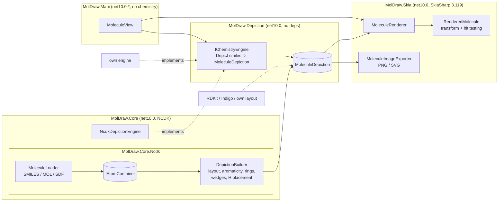

# Architecture

## Layers and package boundaries

| Assembly | Allowed dependencies | Why |
|---|---|---|
| `MolDraw.Depiction` | none | Shared contract between chemistry and rendering: the depiction model plus the `IChemistryEngine` seam |
| `MolDraw.Core` | Depiction, NCDK, DI abstractions | All NCDK usage lives here; replaceable |
| `MolDraw.Skia` | Depiction, SkiaSharp, DI abstractions | No NCDK (no LGPL), no MAUI → Avalonia/server |
| `MolDraw.Maui` | Depiction, Skia, MAUI, SkiaSharp.Views.Maui | Only wiring: bindable properties, gestures, theme — and no chemistry toolkit |

The depiction model lives in its own tiny package because Core must not reference SkiaSharp and Skia must not reference
NCDK; putting the model in either would break one of the two rules. The `IChemistryEngine` seam lives there too, so that
`MolDraw.Maui` can stay free of NCDK while still depicting SMILES.

Inside `MolDraw.Core` the namespace marks the boundary: **only `MolDraw.Core.Ncdk` mentions `NCDK.IAtomContainer`**
(`IMoleculeLoader`, `MoleculeLoader`, `IDepictionBuilder`, `DepictionBuilder`, `NcdkDepictionEngine`, plus
`MoleculeLoaderOptions`/`MoleculeFormat`). Everything in `MolDraw.Depiction` — `DepictionBuildOptions`,
`CarbonLabelMode`, the exceptions — is engine-neutral, so another engine can reuse it.

## Engine boundary

Two levels, both NCDK-free from the consumer's point of view:

1. **Data contract** — `MoleculeDepiction` is all the renderer, the exporter and `MoleculeView.Depiction` need. Build it
   from any toolkit and nothing on that path touches NCDK.
2. **`IChemistryEngine`** — `Name` plus `Depict(smiles, options) → MoleculeDepiction`. This is what `MoleculeView.Smiles`
   calls, so an alternative engine also gets the cache, the background thread and the error handling for free. The NCDK
   implementation (`NcdkDepictionEngine`) is a thin adapter over `IMoleculeLoader` + `IDepictionBuilder`.

Registration is a single `TryAddSingleton`, so any engine registered before `AddMolDrawCore()` wins; `MolDraw.Maui`
resolves `IChemistryEngine` from the DI container and reports a missing engine via `ErrorMessage` instead of throwing.

What that means for candidate engines (checked against nuget.org, 2025):

| Engine | .NET binding | Natives | Usable for |
|---|---|---|---|
| NCDK 1.6.1 | managed | none | all targets incl. Android/iOS/ARM64 — the default |
| Indigo | `Indigo.Net` 1.49.0 (official EPAM binding, netstandard2.0) | win-x64/x86/arm64, linux-x64/arm64, osx-x64/arm64, no android/ios | desktop/server; ~54 MB |
| RDKit | community wrappers only (`RDKit2DotNetStandard`, `RDKit.DotNetWrap`) | none shipped | not turnkey — needs self-built natives |

Consequently the MAUI path stays NCDK-only *by default*; a second engine would come as a separate package implementing
`IChemistryEngine`. To make that render consistently, one thing is still missing:

* The heuristics that `DepictionBuilder` derives from NCDK knowledge (`ShowLabel`/`CarbonLabelMode`, `KekuleOrder`,
  `DoubleBondPlacement`, `HydrogenPosition`, ring sets) live in `MolDraw.Core.Ncdk`, so a second engine would have to
  reimplement them (or a shared post-processing step over `MoleculeDepiction` would have to be extracted).

## Depiction model

`MoleculeDepiction` (atoms, bonds, rings) is immutable and validated on construction (`Atoms[i].Index == i`,
bond indices, finite coordinates). Coordinates are model units with y up (any bond length; renderers normalise by the
median bond length). Bond semantics:

* `Order` is the depicted order; aromatic bonds have `Aromatic` plus `KekuleOrder` (single/double) so the renderer
  can draw Kekulé or circle style.
* `Stereo`: the narrow end of a wedge/hash is `Begin` (NCDK "inverted" wedges are normalised by swapping ends).
* `Placement` of the second double-bond line is relative to Begin→End in model space (`Left` = +90°).

## Core (NCDK)

Everything NCDK-specific lives in the `MolDraw.Core.Ncdk` namespace.

* `MoleculeLoader`: `SmilesParser` (Silent builder, kekulised) per call → thread-safe. NCDK messages
  (`could not parse 'CC(', Unclosed branch…\nCC(\n  ^`) are converted to `MoleculeParseException`
  with `Position` and `Details`. Simple explicit H are suppressed with `AtomContainerManipulator.SuppressHydrogens`
  (in place, preserves atom order) to match RDKit.
* `DepictionBuilder` works on a clone:
  1. implicit H counts (atom typing + `CDKHydrogenAdder` if missing)
  2. `StructureDiagramGenerator.GenerateCoordinates` when coordinates are missing/degenerate (or `ForceLayout`);
     this also runs NCDK's internal `NonplanarBonds` → wedges/hashes from tetrahedral stereo
  3. ring flags + SSSR (`Cycles.FindSSSR`), Daylight aromaticity if the input has no aromatic flags,
     Kekulisation for aromatic bonds without orders
  4. wedge fallback (`WedgeAssigner`) when coordinates exist but no wedges: one bond per centre, wedge/hash chosen
     from the signed volume of the ligands; the sign convention is verified against NCDK's own wedges in tests
  5. double bond placement: ring bonds towards the centroid of the preferred ring (most double bonds, 6-ring);
     acyclic bonds by substituent side, terminal C=O next to two substituents centred
  6. hydrogen label side from free directions (right, left, below, above)

Findings while building it:

* `NonplanarBonds` is internal in NCDK 1.6.1, hence the small fallback assigner.
* NCDK 1.6.1's `StructureDiagramGenerator` corrupts the `Ligands` list of tetrahedral centres with an implicit H
  (focus replaced by a duplicate). Production code is unaffected (the fallback only runs without layout); tests lay out
  a copy.
* NCDK wraps atoms in container-specific references, so atoms are compared by index, not by reference.
* `NCDK.Display` is net461/WPF and therefore not used; NCDK itself references only `netstandard` (no System.Drawing).

## Skia renderer

`MoleculeRenderer.Render` is stateless apart from a typeface cache:

1. **Frame**: model bounds incl. label extents (measured at nominal size) and highlight disc margins → uniform scale
   `min(fit, MaxBondLength / medianBond)`, centred, y flipped. Font size and line width scale with the molecule when it
   is drawn smaller than nominal. Layout does not depend on highlight colours, so recolouring is stable.
2. **Highlights** (bottom layer): bond bands, then discs (solid in a single layer for uniform opacity, or soft radial),
   colour from explicit colours or weight → colour map.
3. **Bonds**: clipped against label rectangles (Liang–Barsky), single/double/triple/aromatic, wedge (filled triangle),
   hash, wavy; optional per-atom bond colouring.
4. **Labels** with `SKFont` only (no obsolete `SKPaint` text API, 4.x-ready): symbol centred on the atom, isotope
   superscript, implicit H with subscript count on the chosen side, charge superscript, radical dots. No opaque
   label backgrounds, so highlights stay visible.
5. Atom indices, selection/hover rings, colour bar.

`RenderedMolecule` exposes the transform and atom positions; `HitTestAtom` (nearest within disc radius + tolerance) and
`HitTestBond` (distance to segment, excluding atom discs).

## MAUI control

`MoleculeView : ContentView` hosts an `SKCanvasView` and contains no chemistry/rendering logic:

* Input precedence `Depiction` > `Smiles`. SMILES results are cached in `IDepictionCache` (LRU);
  uncached work runs via `Task.Run` (cold NCDK start-up and layout take ~100 ms+), stale results are dropped by a
  version counter. Exceptions become `ErrorMessage` and are drawn in the control.
* The canvas is scaled to device-independent units, so hit testing uses gesture positions directly.
* `TapGestureRecognizer` / `PointerGestureRecognizer` → `RenderedMolecule.HitTestAtom`.
* Services come from the constructor or the MAUI service provider: `IChemistryEngine` (optional — a missing engine sets
  `ErrorMessage`), `IMoleculeRenderer`, `IDepictionCache`.
* `RenderOptions == null` follows `Application.RequestedTheme` (subscribed on `Loaded`, unsubscribed on `Unloaded`).

## Target frameworks

All libraries target `net10.0`. `MolDraw.Maui` selects its platform TFMs by build OS (Windows → windows; macOS →
android/ios/maccatalyst) with opt-in switches (`MolDrawAllTargets`, `MolDrawAndroid`, …). Workload pack folders are
not used for detection because stale packs of older SDKs make that unreliable. `TargetFrameworks` is composed with
plain property appends – a property function such as `$(TargetFrameworks.Trim(';'))` must not be used, because MSBuild
escapes the semicolons it returns and the SDK then sees a single combined target framework (NETSDK1046). The library
also sets `AppendRuntimeIdentifierToOutputPath=false`, so a RID-specific build of a consuming WinUI app finds
`MolDraw.Maui.pri` (otherwise PRI175/PRI252).

## Architectures

There is no architecture-specific code: everything above SkiaSharp is managed (`net10.0`/platform TFMs) and the native
Skia binaries are supplied by SkiaSharp's runtime packages for the consuming app's RID (`win-arm64`, `android-arm64`,
`osx`, `maccatalyst`, `ios`). x64 and ARM64 are therefore supported without extra package variants; verified on
win-arm64 (tests, WinUI publish, console rendering from the packed NuGet packages) and android-arm64 (arm64-v8a APK).

## Packaging and licensing

Four packages with Apache-2.0 license expression, README, XML docs, snupkg symbols, SourceLink and deterministic
builds (`Directory.Build.props`), central versions in `Directory.Packages.props`. NCDK (LGPL-2.1-only) is a normal
NuGet dependency of `MolDraw.Core` – it is neither embedded nor merged, so MolDraw.Net itself can use a permissive
license; applications that redistribute NCDK must follow the LGPL (see THIRD-PARTY-NOTICES.md). `MolDraw.Depiction`,
`MolDraw.Skia` and `MolDraw.Maui` are NCDK-free, so a MAUI app without `MolDraw.Core` (or with its own
`IChemistryEngine`) never ships LGPL code.
